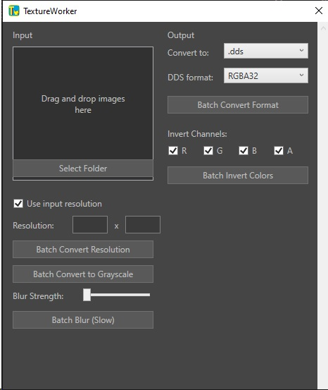
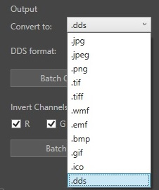
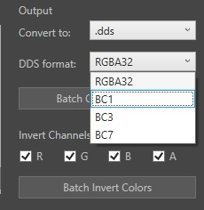

#  TextureWorker


#  Software Interface:
  - 

  - 

  - 

#  Introduction:

  1. Batch convert image formats

  2. Batch convert image resolutions

  3. Batch convert images to grayscale

  5. Batch blur images

  6. Batch invert colors (supports channel selection)

### *This software is free for anyone to use, ad-free, and open-source.*
```[cite: 1]